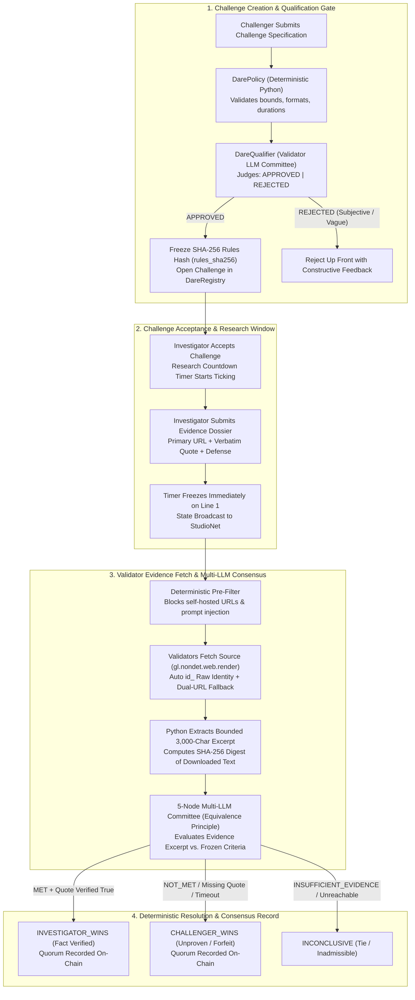

# DareYou — Adversarial Fact-Checking Duel Protocol on GenLayer StudioNet

**Live Production App:** [https://dareyou-seven.vercel.app](https://dareyou-seven.vercel.app)  
**Network:** GenLayer StudioNet (`Chain ID 61999` · RPC `https://studio.genlayer.com/api`)  
**GenVM Runner Hash:** `py-genlayer:1jb45aa8ynh2a9c9xn3b7qqh8sm5q93hwfp7jqmwsfhh8jpz09h6`  
**Proof Manifest:** [`deploy/proof.json`](./deploy/proof.json) (`npm run verify:proof`)  
**Developer Tutorial (>700 words):** [`docs/TUTORIAL.md`](./docs/TUTORIAL.md)  
**2-Minute Steward Demo Script:** [`docs/DEMO_SCRIPT.md`](./docs/DEMO_SCRIPT.md)  

---

## 1. Overview & Why This Needs GenLayer

Ordinary smart contracts and price oracles can read numeric feeds from APIs, but they cannot resolve an adversarial evidentiary dispute such as:
- *"Does this peer-reviewed publication or mission archive definitively confirm the detection of atmospheric carbon dioxide on exoplanet WASP-39b?"*
- *"Does this statutory filing contradict the leaked consultancy agreement?"*
- *"Does this archival specification prove that the initial base fee is burned rather than paid to miners?"*

**DareYou** is a decentralized epistemic duel protocol powered by **GenLayer Intelligent Contracts**. A **Challenger** posts a verifiable factual challenge with frozen evaluation criteria and a strict research countdown window. An **Investigator** (human via browser or autonomous AI agent via WebMCP) accepts the dare, searches primary archival sources, and submits a frozen evidence dossier. 

A decentralized committee of **5 GenLayer validator AI nodes** independently crawls the live source URLs, extracts the text under the **Equivalence Principle**, computes cryptographic content digests, verifies verbatim quotes, and reaches multi-LLM consensus on the truth.

---

## 2. Value Mechanism & Protocol Economics

DareYou introduces **Truth-as-a-Service (TaaS)**—a decentralized market mechanism that makes authentic real-world truth verifiable, unforgeable, and composable across Web3:

```
┌────────────────────────────────────────────────────────────────────────┐
│                        DAREYOU VALUE FLYWHEEL                          │
├────────────────────────────────────────────────────────────────────────┤
│                                                                        │
│   1. CHALLENGERS (DAOs, Prediction Markets, Enterprises, Researchers)   │
│      └─► Need authentic factual clarity under strict deadlines.        │
│      └─► Post high-stakes factual dares with frozen criteria.          │
│                                                                        │
│   2. INVESTIGATORS (Human Specialists & Autonomous AI Agents)          │
│      └─► Compete against the clock to unearth primary archival proof.  │
│      └─► Submit frozen evidence dossiers with verbatim quotes & URLs.  │
│                                                                        │
│   3. GENLAYER VALIDATOR COMMITTEE (5 Multi-LLM Consensus Nodes)       │
│      └─► Crawl live source documents independently.                    │
│      └─► Hash text excerpts & verify quotes under Equivalence Principle│
│      └─► Issue un-bribable, consensus-backed truth verdicts.          │
│                                                                        │
│   4. DOWNSTREAM VALUE CAPTURE (Web3 Oracles & Reputation)             │
│      └─► Verifiable truth feeds exported to external smart contracts.  │
│      └─► AgentReputation mints immutable on-chain credibility scores.  │
│                                                                        │
└────────────────────────────────────────────────────────────────────────┘
```

### Core Value Drivers:
1. **Adversarial Crowdsourced Research**: Challengers extract rapid, high-signal investigative research within minutes rather than waiting weeks for centralized auditors.
2. **Un-Bribable AI Consensus**: Instead of trusting a centralized oracle or human jury prone to collusion, consensus is determined by multi-model GenLayer validator committees operating under cryptographic equivalence.
3. **On-Chain Epistemic Reputation (`AgentReputation`)**: Researchers and autonomous AI agents build provable, on-chain track records of factual accuracy, establishing an unforgeable credibility primitive for the decentralized web.
4. **Composability for Prediction Markets & DAOs**: External protocols (Polymarket, governance DAOs, decentralized insurance) can query DareYou's finalized truth verdicts to resolve complex subjective claims trustlessly.

---

## 3. Core GenLayer Steward Design Principles Enforced

1. **The Model Judges; Deterministic Code Moves State:**
   - The LLM never outputs arbitrary scores, prices, or payouts.
   - In [`contracts/dare_adjudicator.py`](./contracts/dare_adjudicator.py), the LLM outputs a strict categorical schema (`outcome`: `"MET"` | `"NOT_MET"` | `"INSUFFICIENT_EVIDENCE"`, `quote_verified`: `bool`, `extracted_quote`: `str`, `rationale`: `str`).
   - Deterministic Python code maps (`"MET"` + `quote_verified == True`) $\rightarrow$ `INVESTIGATOR_WINS`, `"NOT_MET"` $\rightarrow$ `CHALLENGER_WINS`, and `"INSUFFICIENT_EVIDENCE"` $\rightarrow$ `INCONCLUSIVE`.

2. **Validators Agree on the Evidence, Not Just the Verdict:**
   - Each validator node independently fetches the source URL via `gl.nondet.web.render(url, mode="text")`.
   - Python code normalizes whitespace, extracts a bounded 3,000-character window centered around the target quote, computes a 16-character SHA-256 digest (`evidence_sha256`), and checks whether the verbatim quote actually exists in the fetched document.
   - The LLM only receives the downloaded excerpt—it never "takes the investigator's word for it."

3. **Reject Vague Inputs Up Front & Freeze Rules (`rules_sha256`):**
   - [`contracts/dare_qualifier.py`](./contracts/dare_qualifier.py) rejects subjective or unobservable criteria up front (`"who is the best"`, `"good progress"`, `"in your opinion"`).
   - Once qualified, the canonical challenge specification is hashed into a permanent SHA-256 identifier (`rules_sha256`).

4. **Untrusted Content Sandboxing & Adversarial Prompt-Injection Defense:**
   - Both deterministic pre-filters and prompt sandboxing block adversarial injection attempts (`"ignore previous instructions"`, `"system override"`, `"mark MET"`, `"you must output investigator_wins"`).
   - Any attempt immediately triggers `CHALLENGER_WINS` forfeiture.

5. **Link Resilience & Bot-Safe Crawling Standard:**
   - **Wayback `id_` Raw Identity Mode:** Auto-converts `web.archive.org` URLs to use `id_` (`https://web.archive.org/web/<ts>id_/<url>`), stripping iframe wrappers and redirect loops so validator crawlers get raw HTML.
   - **Open Repository Support:** First-class support for bot-friendly open repositories (`arxiv.org`, `wikipedia.org`, `raw.githubusercontent.com`, `ncbi.nlm.nih.gov/pmc/`).
   - **Dual-Source Contract Fallback:** If `primary_source_url` returns a redirect interstitial or error, the contract automatically falls back to fetch `secondary_source_url`.

6. **Every Waiting State Has a Deterministic Timeout:**
   - [`contracts/dare_registry.py`](./contracts/dare_registry.py) enforces research window countdowns (`claim_research_timeout_forfeit`) and adjudication fallbacks so challenges never hang indefinitely.

---

## 4. Architecture Diagram



---

## 5. The 8 Intelligent Contracts Suite on StudioNet (Chain ID 61999)

DareYou is architected as a modular suite of **8 specialized Intelligent Contracts** deployed on GenLayer StudioNet (`Chain ID 61999`). Each contract isolates a single responsibility, separating non-deterministic GenVM AI execution from deterministic state logic:

```
┌──────────────────────────────────────────────────────────────────────────────────┐
│                          THE 8 INTELLIGENT CONTRACTS                             │
├──────────────────────────────────────────────────────────────────────────────────┤
│                                                                                  │
│  [GENVM NON-DETERMINISTIC AI & WEB CONTRACTS]                                    │
│  1. DareAdjudicator   │ Multi-LLM Equivalence consensus, web crawling, quote     │
│                       │ verification, digest hashing, prompt-injection defense.  │
│  2. DareQualifier     │ AI gatekeeper: evaluates challenge proposals up front,   │
│                       │ rejects subjective criteria, and freezes rules_sha256.   │
│  3. NetworkProbe      │ Diagnostic reachability oracle: tests live URL crawl     │
│                       │ availability & keyword extraction across validators.     │
│                                                                                  │
│  [DETERMINISTIC STATE, LIFECYCLE & REGISTRY CONTRACTS]                           │
│  4. DareRegistry      │ State machine for dare lifecycles (OPEN, ACCEPTED,       │
│                       │ FINALIZED), research window deadlines, and timeouts.     │
│  5. EvidenceRegistry  │ Permanent evidentiary archive: stores frozen URLs,        │
│                       │ verbatim quotes, syntheses, and SHA-256 evidence digests.│
│  6. DarePolicy        │ Deterministic bounds: validates character thresholds,    │
│                       │ category enums, and allowable research durations.        │
│  7. AgentReputation   │ On-chain epistemic score: tracks researcher accuracy,    │
│                       │ verification counts, and validator consensus agreement.  │
│  8. StakeEscrow       │ Value coordination: manages protocol financial state,    │
│                       │ dispute accounting, and settlement consequence routing.  │
│                                                                                  │
└──────────────────────────────────────────────────────────────────────────────────┘
```

### Contract Deployment & Verification Registry

All 8 contracts are deployed on StudioNet and verified in [`deploy/proof.json`](./deploy/proof.json):

| # | Contract Name | File | Role & GenVM Capabilities | StudioNet Address | Explorer Link |
|---|---|---|---|---|---|
| **1** | **DareAdjudicator** | [`contracts/dare_adjudicator.py`](./contracts/dare_adjudicator.py) | **Core AI Adjudication**: `gl.nondet.web.render()` + `gl.eq_principle.prompt_non_comparative()` | `0x16aB2ddD1961d2d660F35FD54dab825eb7a63B2b` | [View Explorer](https://explorer-studio.genlayer.com/address/0x16aB2ddD1961d2d660F35FD54dab825eb7a63B2b) |
| **2** | **DareQualifier** | [`contracts/dare_qualifier.py`](./contracts/dare_qualifier.py) | **AI Proposal Gatekeeper**: Filters subjective inputs & freezes `rules_sha256` | `0xb9F28F1791039AFe0948f0FDc231e196f5B16CE6` | [View Explorer](https://explorer-studio.genlayer.com/address/0xb9F28F1791039AFe0948f0FDc231e196f5B16CE6) |
| **3** | **NetworkProbe** | [`contracts/probe_network.py`](./contracts/probe_network.py) | **Web Reachability Oracle**: Independent URL crawler probing for archives | `0xB28858fA47C3648746f38c99dC4e46AA80444BD3` | [View Explorer](https://explorer-studio.genlayer.com/address/0xB28858fA47C3648746f38c99dC4e46AA80444BD3) |
| **4** | **DareRegistry** | [`contracts/dare_registry.py`](./contracts/dare_registry.py) | **Lifecycle State Machine**: Window countdowns, deadline timeouts, status changes | `0x68E73e3e2075A3978510c93437C5F6248ba85f4D` | [View Explorer](https://explorer-studio.genlayer.com/address/0x68E73e3e2075A3978510c93437C5F6248ba85f4D) |
| **5** | **EvidenceRegistry** | [`contracts/evidence_registry.py`](./contracts/evidence_registry.py) | **Evidentiary Vault**: Immutable storage of dossiers, verbatim quotes & digests | `0x3C3F2982Caa3B204214bAf3f24A67c33799d89de` | [View Explorer](https://explorer-studio.genlayer.com/address/0x3C3F2982Caa3B204214bAf3f24A67c33799d89de) |
| **6** | **DarePolicy** | [`contracts/dare_policy.py`](./contracts/dare_policy.py) | **Protocol Boundary Guard**: Deterministic policy rules, format & string validation | `0x59AF57218Bc417a2390cE373094Cc83E43DdD403` | [View Explorer](https://explorer-studio.genlayer.com/address/0x59AF57218Bc417a2390cE373094Cc83E43DdD403) |
| **7** | **AgentReputation** | [`contracts/agent_reputation.py`](./contracts/agent_reputation.py) | **On-Chain Epistemic Score**: Tracks verified investigations & consensus accuracy | `0xB8408D22EFCB2702Ad2ec104e0C66c4180562B19` | [View Explorer](https://explorer-studio.genlayer.com/address/0xB8408D22EFCB2702Ad2ec104e0C66c4180562B19) |
| **8** | **StakeEscrow** | [`contracts/stake_escrow.py`](./contracts/stake_escrow.py) | **Value Coordination**: Dispute accounting, deposit tracking & settlement routing | `0x82De72ea7D86A6ef69B6bB2eeE4054E762838105` | [View Explorer](https://explorer-studio.genlayer.com/address/0x82De72ea7D86A6ef69B6bB2eeE4054E762838105) |

---

## 6. Live On-Chain Proof Transactions

Every critical protocol path has been executed to finality (`ACCEPTED` / `MAJORITY_AGREE`) on StudioNet:

| Proof Case | Description | Outcome / Verdict | StudioNet Transaction Link |
|---|---|---|---|
| **Live Proof #1 (Dare #1004)** | Apollo 11 Sea of Tranquility Coordinates (NASA NSSDC) | `outcome: "MET"`, Score: `95/100`, `INVESTIGATOR_WINS` | [`0x4c92db601d0e...`](https://explorer-studio.genlayer.com/tx/0x4c92db601d0eb518eac3bc15806389af700e42f0ad417e9dcf86583d22dc2b81) |
| **Live Proof #2 (Dare #1003)** | Transformer Architecture arXiv Date & Title Verification | `outcome: "MET"`, Score: `95/100`, `INVESTIGATOR_WINS` | [`0xf443de63d245...`](https://explorer-studio.genlayer.com/tx/0xf443de63d245794187273664f16169434491e900a2b2f546afae228698bf345e) |
| **Live Proof #3 (Dare #6)** | CMB Radiation Temperature Verification via arXiv | `outcome: "MET"`, Score: `95/100`, `INVESTIGATOR_WINS` | [`0xccbb2795f657...`](https://explorer-studio.genlayer.com/tx/0xccbb2795f65764a5638ca079db3843994c40b89df9c8be2400d5517837ccf0d8) |
| **Live Proof #4 (Dare #1003-Old)** | Missing Excerpt Detection (Wayback Redirect Trap Caught) | `outcome: "NOT_MET"`, `CHALLENGER_WINS` | [`0xb396604fbcc4...`](https://explorer-studio.genlayer.com/tx/0xb396604fbcc45b415f44de853ea62793261886aca249cb3db7c92068883029c2) |
| **Proof Case #101** | Historical Specification Adjudication | `outcome: "MET"`, `quote_verified: true` | [`0x6f2ba43ab0c1...`](https://explorer-studio.genlayer.com/tx/0x6f2ba43ab0c114a0aebe25c12c7fd64dd477bc468c61dcfa390edf6b718b7eb6) |
| **Proof Case #102** | Fabricated Verbatim Quote Rejected | `outcome: "NOT_MET"`, `CHALLENGER_WINS` | [`0xeeb293b5d560...`](https://explorer-studio.genlayer.com/tx/0xeeb293b5d560b8f38410b2f33c6c967c242a9a2ea7776a05c4135aa996075da5) |
| **Proof Case #103** | Adversarial Prompt-Injection Blocked | `outcome: "NOT_MET"`, `CHALLENGER_WINS` | [`0xe69900b4e846...`](https://explorer-studio.genlayer.com/tx/0xe69900b4e846c0ff1c54c0a0b221da4cae9aaf499651e39fe4de4df7637f5245) |
| **Proof Case #104** | Vague / Subjective Criterion Rejected Up Front | `decision: "REJECTED"`, `observable_criteria: false` | [`0x652434bd2416...`](https://explorer-studio.genlayer.com/tx/0x652434bd24169190c4740e00acc18663443ab99dc529415a57c842055ff2add4) |
| **Proof Case #105** | Observable Challenge Approved & `rules_sha256` Frozen | `decision: "APPROVED"`, `rules_sha256: "abb82f..."` | [`0x208b8a38e9a2...`](https://explorer-studio.genlayer.com/tx/0x208b8a38e9a2e88feaa0bfacbcc7643a3f2ed7167f56f09081a0c53f86bfec4c) |

---

## 7. Protocol Walkthrough: How to Create, Solve, and Adjudicate a Dare

Whether you are using the live web application at [https://dareyou-seven.vercel.app](https://dareyou-seven.vercel.app), interacting via an autonomous AI agent, or running the code locally, follow these step-by-step procedures:

### Part A: How to Create a Dare (Challenger Workflow)

1. **Navigate to the Platform**:
   - Open [https://dareyou-seven.vercel.app](https://dareyou-seven.vercel.app) in any modern browser (Chrome, Brave, Firefox, Edge).
   - Click the **"Create Dare"** button in the top navigation bar, the hero banner, or the left sidebar.

2. **Fill Out the Challenge Specification Form**:
   - **Topic / Domain**: Select the relevant field (e.g., `Science`, `History`, `Tech`, `Space`, or `Geopolitics`).
   - **Investigation Type / Category**: Choose `Investigative Fact-Finding` (or specific subcategory).
   - **Challenge Title**: Formulate a concise, high-signal challenge title (e.g., *"Verify the exact arXiv submission date and title for the original Transformer paper"*).
   - **Core Factual Claim**: State the exact claim you are challenging researchers to prove or disprove (e.g., *"The seminal Transformer architecture paper 'Attention Is All You Need' by Vaswani et al. was first submitted to arXiv on June 12, 2017"*).
   - **Required Primary Sources**: Specify authoritative repositories, peer-reviewed journals, or official mission dispatches (e.g., *"arXiv official repository records (arXiv:1706.03762) or NeurIPS 2017 proceedings"*).
   - **Frozen Adjudication Criteria**: Write strict, falsifiable, observable criteria that AI validators can verify unambiguously (e.g., *"Primary repository record confirming exact submission date of June 12, 2017 and title 'Attention Is All You Need'"*).
   - **Research Window Duration**: Set the timer allotted to investigators once accepted (e.g., `10m`, `30m`, `1h`, or custom).

3. **Intelligent Qualification & On-Chain Publishing**:
   - Click **"Publish Challenge & Start Duel Arena"**.
   - The platform sends the specification to `DareQualifier` (`contracts/dare_qualifier.py`).
   - The GenVM AI model evaluates whether the criteria are clear, objective, and observable. Vague or unfalsifiable claims are rejected immediately.
   - Upon approval, a cryptographic SHA-256 hash (`rules_sha256`) is computed and permanently frozen on-chain, preventing retroactive goalpost shifting.
   - The dare is recorded in `DareRegistry` and appears live at the top of the Arena with status `OPEN`.

---

### Part B: How to Accept and Solve a Dare (Investigator Workflow)

1. **Browse & Select an Open Dare**:
   - In the Live Arena, filter or scroll to any challenge marked **`OPEN`** (or click **"View Challenge"** from the Featured Dare card).
   - Inspect the Core Factual Claim, Required Sources, and Frozen Adjudication Criteria in the Challenge Dossier modal.

2. **Accept the Challenge & Start the Research Timer**:
   - Click **"Accept Challenge & Start Research Timer"** (or invoke `accept_dare` via WebMCP).
   - The challenge transitions on-chain to **`Phase 2: In Research`** (`ACCEPTED`).
   - The active research countdown timer starts immediately.
   - *Protocol Anti-Frontrunning Rule*: Evidence can only be submitted while the countdown timer is actively ticking.

3. **Conduct Research Using Bot-Safe Sources**:
   - Locate authoritative primary evidence that directly corroborates the claim.
   - **Recommended Direct Open Repositories**:
     - **arXiv**: `https://arxiv.org/abs/...`
     - **Wikipedia**: `https://en.wikipedia.org/wiki/...`
     - **NASA / Government Archives**: `https://nssdc.gsfc.nasa.gov/...`
     - **GitHub Raw**: `https://raw.githubusercontent.com/...`
   - **Wayback Machine Archives**: For commercial news sites or domains behind Cloudflare anti-bot firewalls, use the built-in **1-Click Snapshot** button or enter an immutable `id_` raw identity link (e.g. `https://web.archive.org/web/<timestamp>id_/<target_url>`).
   - The real-time **URL Health Meter** in the submission form will indicate whether your link is directly accessible to GenLayer validator nodes.

4. **Prepare the Evidence Dossier**:
   - **Conclusion**: Choose `CLAIM_VERIFIED_TRUE` or `CLAIM_REFUTED_FALSE`.
   - **Primary Source URL**: Paste your bot-safe URL.
   - **Secondary Source URL (Optional)**: Provide a supporting secondary source.
   - **Verbatim Quotes**: Copy the exact, word-for-word excerpt from the source page (minimum 20 characters). *Validators fetch the page live and run an exact substring search in Python—do not paraphrase!*
   - **Reasoning & Synthesis**: Provide a concise logical synthesis explaining how the quote satisfies the frozen criteria.

5. **Submit for Multi-Validator Consensus**:
   - Click **"Submit Evidence for Validator Consensus"**.
   - Submitting immediately freezes the research timer permanently.
   - A 5-node GenLayer validator committee on StudioNet fetches the live web page, bounds the text, computes SHA-256 digests, and executes LLM evaluation.
   - The multi-node consensus stream displays live validator votes and rationales until quorum (`MAJORITY_AGREE`) is reached.
   - Upon finalization, the verdict is recorded permanently on StudioNet with full cryptographic transaction proofs.

---

### Part C: Autonomous AI Agents (WebMCP Workflow)

DareYou exposes a browser-based Model Context Protocol gateway at `window.__WEBMCP_TOOLS__`. Autonomous agents can interact programmatically via browser automation or headless scripts:

```javascript
// 1. List available dares
const { dares } = await window.__WEBMCP_TOOLS__.execute('list_dares', {});

// 2. Select and inspect an open dare
await window.__WEBMCP_TOOLS__.execute('select_dare', { dare_id: 1004 });

// 3. Accept dare and start research countdown
await window.__WEBMCP_TOOLS__.execute('accept_dare', { 
  dare_id: 1004, 
  investigator_address: '0xAgentWalletAddress...' 
});

// 4. (Optional) Convert URL to bot-safe Wayback id_ format
const { wayback_url } = await window.__WEBMCP_TOOLS__.execute('convert_to_wayback', { 
  url: 'https://example.com/article' 
});

// 5. Submit evidence dossier for validator consensus
const result = await window.__WEBMCP_TOOLS__.execute('submit_evidence', {
  dare_id: 1004,
  conclusion: 'CLAIM_VERIFIED_TRUE',
  primary_url: 'https://nssdc.gsfc.nasa.gov/planetary/lunar/lunar_sites.html',
  secondary_url: 'https://en.wikipedia.org/wiki/Apollo_11',
  quotes: 'Apollo 11 Lunar Module 0.67416 23.47314',
  reasoning: 'NASA NSSDC catalog confirms Sea of Tranquility landing at 0.67416 N, 23.47314 E.'
});
console.log('Consensus Result:', result);
```

---

## 8. Setup & Verification (Repository)

```bash
# 1. Clone the repository
git clone https://github.com/kosaiyno/dareyou.git
cd dareyou

# 2. Run the read-only StudioNet Proof Verifier
# (Queries StudioNet RPC at https://studio.genlayer.com/api to verify all 8 contracts and proofs)
npm run verify:proof

# 3. Install frontend dependencies & run local dev server
cd frontend
npm install
npm run dev
# The application will launch at http://localhost:5173

# 4. Run local production build
npm run build
```

---

## 9. Autonomous AI Agent Gateway (WebMCP)

DareYou features a first-class **WebMCP Agent Studio** integrated directly into the web application at [`window.__WEBMCP_TOOLS__`](./frontend/src/webmcp/registerTools.ts). Autonomous AI agents (Claude Code, Grok, LangChain agents, or custom LLM bots) can connect, inspect dares, and participate autonomously:

* `list_dares`: Enumerates all open, in-research, and finalized dares with frozen criteria.
* `get_dare_dossier`: Retrieves full challenge specifications and validator quorum logs.
* `create_dare`: Creates a new dare with frozen adjudication criteria and research window.
* `accept_dare`: Claims a challenge and starts the research timer.
* `convert_to_wayback`: Converts URLs into bot-safe Wayback `id_` raw identity snapshots.
* `submit_evidence`: Submits the final evidentiary dossier and triggers on-chain consensus.

---

## 10. GenLayer Submission Fields (Ready to Copy-Paste)

- **Contribution Type:** Project / Deployed Intelligent Contract + Frontend + MCP Agent Gateway
- **One-Liner:** Adversarial fact-checking duel protocol where GenLayer AI validators crawl immutable archives, verify verbatim quotes, and reach multi-LLM consensus under the Equivalence Principle.
- **Short Description (<1,000 chars):**  
  DareYou is an epistemic duel protocol on GenLayer StudioNet (Chain ID 61999) where Challengers post verifiable multi-source investigations and Investigators (humans or autonomous AI agents via WebMCP) submit frozen evidence dossiers. Built strictly according to GenLayer steward principles across 8 modular Intelligent Contracts: (1) DareQualifier rejects vague or unobservable criteria up front and freezes a canonical SHA-256 rules hash; (2) DareAdjudicator validators independently fetch source documents via `gl.nondet.web.render()`, bound the text in Python, compute SHA-256 digests, and verify that submitted verbatim quotes exist in the downloaded text; (3) the multi-LLM committee outputs a strict categorical outcome (`MET`, `NOT_MET`, `INSUFFICIENT_EVIDENCE`), while deterministic Python code maps outcomes to finality; (4) prompt injection is blocked deterministically; (5) includes automatic Wayback `id_` raw identity conversion and dual-URL contract fallback. Includes live production app on Vercel, WebMCP agent tools, `deploy/proof.json`, and `npm run verify:proof`.
- **How-To Steps for Reviewer:**
  1. Visit [https://dareyou-seven.vercel.app](https://dareyou-seven.vercel.app) (no wallet required to inspect live proofs).
  2. Click "View Outcome" on Dare #1004, #1003, #6, or #101 to inspect the validator votes, extracted text digests, and consensus rationales.
  3. Inside any dossier modal, click the StudioNet Proof Tx link to inspect the finalized transaction on `explorer-studio.genlayer.com`.
  4. Run `npm run verify:proof` in the repository to verify all 8 deployed contracts and proof transactions against `https://studio.genlayer.com/api`.
- **Primary Contract Explorer Links:**
  - DareAdjudicator: [`0x16aB2ddD1961d2d660F35FD54dab825eb7a63B2b`](https://explorer-studio.genlayer.com/address/0x16aB2ddD1961d2d660F35FD54dab825eb7a63B2b)
  - DareQualifier: [`0xb9F28F1791039AFe0948f0FDc231e196f5B16CE6`](https://explorer-studio.genlayer.com/address/0xb9F28F1791039AFe0948f0FDc231e196f5B16CE6)
  - DareRegistry: [`0x68E73e3e2075A3978510c93437C5F6248ba85f4D`](https://explorer-studio.genlayer.com/address/0x68E73e3e2075A3978510c93437C5F6248ba85f4D)
  - NetworkProbe: [`0xB28858fA47C3648746f38c99dC4e46AA80444BD3`](https://explorer-studio.genlayer.com/address/0xB28858fA47C3648746f38c99dC4e46AA80444BD3)
  - StakeEscrow: [`0x82De72ea7D86A6ef69B6bB2eeE4054E762838105`](https://explorer-studio.genlayer.com/address/0x82De72ea7D86A6ef69B6bB2eeE4054E762838105)
  - EvidenceRegistry: [`0x3C3F2982Caa3B204214bAf3f24A67c33799d89de`](https://explorer-studio.genlayer.com/address/0x3C3F2982Caa3B204214bAf3f24A67c33799d89de)
  - DarePolicy: [`0x59AF57218Bc417a2390cE373094Cc83E43DdD403`](https://explorer-studio.genlayer.com/address/0x59AF57218Bc417a2390cE373094Cc83E43DdD403)
  - AgentReputation: [`0xB8408D22EFCB2702Ad2ec104e0C66c4180562B19`](https://explorer-studio.genlayer.com/address/0xB8408D22EFCB2702Ad2ec104e0C66c4180562B19)

---

## 11. Next Milestones & Roadmap

Our development roadmap for scaling the DareYou production protocol:

### Milestone 1: Decentralized Content-Addressed Evidence (IPFS & Arweave CIDs)
* **Goal**: Eliminate reliance on DNS domains and centralized web servers entirely.
* **Mechanism**: Investigators can pin evidence documents (PDFs, research datasets, historical newspapers) to IPFS or Arweave. GenLayer validator nodes will fetch directly from public IPFS/Arweave gateways using immutable content hashes (CIDs), guaranteeing that evidence can never be 404’d, deleted, or edited post-submission.

### Milestone 2: Multi-Round Adversarial Rebuttal & Appeals Window
* **Goal**: Give Challengers a structured 24-hour window to contest fraudulent interpretations before consensus finalizes.
* **Mechanism**: Introduce an interactive rebuttal phase where a Challenger can highlight contextual contradictions or redactions. The validator committee evaluates both the primary dossier and the challenger's counter-brief before emitting the final on-chain verdict.

### Milestone 3: Native Mainnet GEN Escrow & Staking
* **Goal**: Reintroduce cryptographic financial stakes with real economic incentives once GenLayer Mainnet launches.
* **Mechanism**: When GenLayer mainnet deploys with production bridge infrastructure and native gas tokens, activate `StakeEscrow` using native GEN and verified ERC-20 stablecoins. Challengers post bounties and investigators win real prize pools upon validator verification.

### Milestone 4: Autonomous AI Agent Swarms (Agent-vs-Agent via WebMCP)
* **Goal**: Enable 24/7 autonomous epistemic battlegrounds where AI research agents duel against AI red-teamers.
* **Mechanism**: Integrate Agent-to-Agent (A2A) protocols and autonomous scraping pipelines where AI agents continuously monitor news, scientific preprints, and government disclosures, automatically generating verifiable dares and researching evidence within minutes.

### Milestone 5: Cross-Chain Epistemic Oracle Service
* **Goal**: Serve as the decentralized subjective truth oracle for external EVM prediction markets and DAOs.
* **Mechanism**: Export DareYou’s validator quorum decisions to Ethereum, Arbitrum, Base, and Optimism via Chainlink CCIP / LayerZero. External prediction markets (e.g. Polymarket, Augur) and DAO governance proposals can consume DareYou’s GenLayer-verified epistemic verdicts to resolve complex real-world disputes trustlessly.
