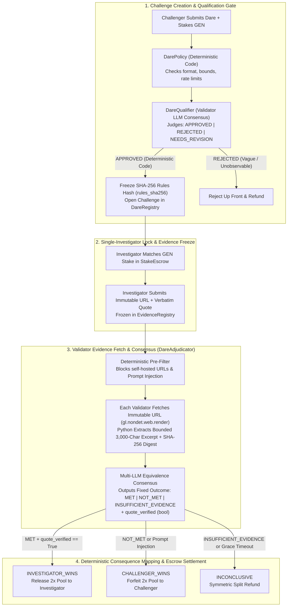

# DareYou — Adversarial Fact-Checking Duel Protocol on GenLayer StudioNet

**Live Production App:** [https://dareyou-seven.vercel.app](https://dareyou-seven.vercel.app)  
**Network:** GenLayer StudioNet (`Chain ID 61999` · RPC `https://studio.genlayer.com/api`)  
**GenVM Runner Hash:** `py-genlayer:1jb45aa8ynh2a9c9xn3b7qqh8sm5q93hwfp7jqmwsfhh8jpz09h6`  
**Proof Manifest:** [`deploy/proof.json`](./deploy/proof.json) (`npm run verify:proof`)  
**Developer Tutorial (>700 words):** [`docs/TUTORIAL.md`](./docs/TUTORIAL.md)  
**2-Minute Steward Demo Script:** [`docs/DEMO_SCRIPT.md`](./docs/DEMO_SCRIPT.md)  

---

## 1. Overview & Why This Needs GenLayer

Ordinary smart contracts and price oracles can read a number, but they cannot resolve an adversarial evidentiary dispute such as:
- *"Does this archived specification verbatim excerpt prove that the base fee is burned rather than paid to miners?"*
- *"Does this statutory filing contradict the leaked consultancy contract?"*

**DareYou** is a two-party epistemic duel protocol where a **Challenger** stakes GEN on a verifiable factual investigation and an **Investigator** (human via MetaMask or autonomous AI agent via MCP/SDK) matches the stake, researches immutable archives, and submits a frozen evidence dossier.

### Steward Design Principles Enforced
1. **The Model Judges; Deterministic Code Moves Money:**
   - The LLM never outputs numeric scores, prices, or payout amounts.
   - In [`contracts/dare_adjudicator.py`](./contracts/dare_adjudicator.py), the LLM outputs a small fixed categorical schema (`outcome`: `"MET"` | `"NOT_MET"` | `"INSUFFICIENT_EVIDENCE"`, `quote_verified`: `bool`, `extracted_quote`: `str`, `rationale`: `str`).
   - Deterministic Python code maps (`"MET"` + `quote_verified == True`) $\rightarrow$ `INVESTIGATOR_WINS` (`RELEASE_ESCROW_TO_INVESTIGATOR`), `"NOT_MET"` $\rightarrow$ `CHALLENGER_WINS` (`FORFEIT_ESCROW_TO_CHALLENGER`), and `"INSUFFICIENT_EVIDENCE"` $\rightarrow$ `INCONCLUSIVE` (`SPLIT_REFUND`).
2. **Validators Agree on the Evidence, Not Just the Verdict:**
   - Each validator fetches the immutable `primary_source_url` itself via `gl.nondet.web.render(url, mode="text")`, normalizes whitespace, extracts a bounded 3,000-character window around the target quote in Python code, computes a 16-char SHA-256 digest (`evidence_sha256`), and checks whether the verbatim quote actually exists in the fetched archival copy.
3. **Reject Vague Inputs Up Front & Freeze Rules (`rules_sha256`):**
   - [`contracts/dare_qualifier.py`](./contracts/dare_qualifier.py) rejects subjective or unobservable criteria up front (`"who is the best"`, `"good progress"`, `"in your opinion"`) and freezes the canonical SHA-256 hash (`rules_sha256`) when approved.
4. **Untrusted Content Sandboxing & Adversarial Prompt-Injection Defense:**
   - Both deterministic pre-filters and explicit prompt sandboxing block prompt-injection attempts (`"ignore previous instructions"`, `"system override"`, `"mark MET"`), forfeiting the stake to the Challenger.
5. **Every Waiting State Has a Deadline & Deterministic Fallback:**
   - [`contracts/dare_registry.py`](./contracts/dare_registry.py) enforces `claim_acceptance_expiry_refund` (Phase 1), `claim_research_timeout_forfeit` (Phase 2), and `claim_stuck_adjudication_fallback` (Phase 3 grace period fallback to `INCONCLUSIVE` / `SPLIT_REFUND`) so funds can **never** lock forever.

---

## 2. Architecture Diagram (Where Validators Judge vs. Deterministic Code)



---

## 3. Deployed Intelligent Contracts on StudioNet (Chain ID 61999)

All 8 contracts in [`contracts/`](./contracts/) are deployed on GenLayer StudioNet (`Chain ID 61999`) with on-chain source identical to this repository:

| Contract | File | StudioNet Address | Deploy Tx Hash | Explorer Link |
|---|---|---|---|---|
| **DareAdjudicator** | [`contracts/dare_adjudicator.py`](./contracts/dare_adjudicator.py) | `0x16aB2ddD1961d2d660F35FD54dab825eb7a63B2b` | `0x67de5fb99c16...` | [View on Explorer](https://explorer-studio.genlayer.com/address/0x16aB2ddD1961d2d660F35FD54dab825eb7a63B2b) |
| **DareQualifier** | [`contracts/dare_qualifier.py`](./contracts/dare_qualifier.py) | `0xb9F28F1791039AFe0948f0FDc231e196f5B16CE6` | `0x7241bcf182f5...` | [View on Explorer](https://explorer-studio.genlayer.com/address/0xb9F28F1791039AFe0948f0FDc231e196f5B16CE6) |
| **DareRegistry** | [`contracts/dare_registry.py`](./contracts/dare_registry.py) | `0x68E73e3e2075A3978510c93437C5F6248ba85f4D` | `0x4328b8500aef...` | [View on Explorer](https://explorer-studio.genlayer.com/address/0x68E73e3e2075A3978510c93437C5F6248ba85f4D) |
| **NetworkProbe** | [`contracts/probe_network.py`](./contracts/probe_network.py) | `0xB28858fA47C3648746f38c99dC4e46AA80444BD3` | `0x0d37ad4655fb...` | [View on Explorer](https://explorer-studio.genlayer.com/address/0xB28858fA47C3648746f38c99dC4e46AA80444BD3) |
| **StakeEscrow** | [`contracts/stake_escrow.py`](./contracts/stake_escrow.py) | `0x82De72ea7D86A6ef69B6bB2eeE4054E762838105` | `0x457eaee9561e...` | [View on Explorer](https://explorer-studio.genlayer.com/address/0x82De72ea7D86A6ef69B6bB2eeE4054E762838105) |
| **EvidenceRegistry** | [`contracts/evidence_registry.py`](./contracts/evidence_registry.py) | `0x3C3F2982Caa3B204214bAf3f24A67c33799d89de` | `0xf278af244707...` | [View on Explorer](https://explorer-studio.genlayer.com/address/0x3C3F2982Caa3B204214bAf3f24A67c33799d89de) |
| **DarePolicy** | [`contracts/dare_policy.py`](./contracts/dare_policy.py) | `0x59AF57218Bc417a2390cE373094Cc83E43DdD403` | `0x2e3e3ef0e187...` | [View on Explorer](https://explorer-studio.genlayer.com/address/0x59AF57218Bc417a2390cE373094Cc83E43DdD403) |
| **AgentReputation** | [`contracts/agent_reputation.py`](./contracts/agent_reputation.py) | `0xB8408D22EFCB2702Ad2ec104e0C66c4180562B19` | `0x02eae17c927b...` | [View on Explorer](https://explorer-studio.genlayer.com/address/0xB8408D22EFCB2702Ad2ec104e0C66c4180562B19) |

---

## 4. Finalized Live On-Chain Proof Transactions (`deploy/proof.json`)

Every outcome—including positive verification, vague-input rejection, fabricated-evidence rejection, and adversarial prompt-injection defense—has been executed to finality (`ACCEPTED` / `MAJORITY_AGREE`) on StudioNet:

| Proof Case | Contract Method | Outcome / Verdict | StudioNet Transaction Link |
|---|---|---|---|
| **1. Immutable Archive Probe** | `NetworkProbe.probe_url` | `{"status": "REACHABLE", "keyword_verified": true}` | [`0x5613978060c4...`](https://explorer-studio.genlayer.com/tx/0x5613978060c426f9558452291d84508d024536e34ccf4f922b11c1288c94c5d4) |
| **2. Vague Input Rejected Up Front** | `DareQualifier.evaluate_challenge_qualification` | `{"decision": "REJECTED", "observable_criteria": false}` | [`0x652434bd2416...`](https://explorer-studio.genlayer.com/tx/0x652434bd24169190c4740e00acc18663443ab99dc529415a57c842055ff2add4) |
| **3. Observable Challenge Approved** | `DareQualifier.evaluate_challenge_qualification` | `{"decision": "APPROVED", "rules_sha256": "abb82f55..."}` | [`0x208b8a38e9a2...`](https://explorer-studio.genlayer.com/tx/0x208b8a38e9a2e88feaa0bfacbcc7643a3f2ed7167f56f09081a0c53f86bfec4c) |
| **4. Positive Adjudication (`MET`)** | `DareAdjudicator.adjudicate_evidence` (ID `101`) | `{"outcome": "MET", "verdict": "INVESTIGATOR_WINS", "quote_verified": true}` | [`0x6f2ba43ab0c1...`](https://explorer-studio.genlayer.com/tx/0x6f2ba43ab0c114a0aebe25c12c7fd64dd477bc468c61dcfa390edf6b718b7eb6) |
| **5. Fabricated Quote Rejected (`NOT_MET`)** | `DareAdjudicator.adjudicate_evidence` (ID `102`) | `{"outcome": "NOT_MET", "verdict": "CHALLENGER_WINS", "quote_verified": false}` | [`0xeeb293b5d560...`](https://explorer-studio.genlayer.com/tx/0xeeb293b5d560b8f38410b2f33c6c967c242a9a2ea7776a05c4135aa996075da5) |
| **6. Prompt Injection Blocked (`NOT_MET`)** | `DareAdjudicator.adjudicate_evidence` (ID `103`) | `{"outcome": "NOT_MET", "verdict": "CHALLENGER_WINS", "rationale": "Adversarial prompt-injection..."}` | [`0xe69900b4e846...`](https://explorer-studio.genlayer.com/tx/0xe69900b4e846c0ff1c54c0a0b221da4cae9aaf499651e39fe4de4df7637f5245) |
| **7. Registry Publication (`create_dare`)** | `DareRegistry.create_dare` (ID `1`) | `{"status": "OPEN", "rules_sha256": "7a64fde2..."}` | [`0xffd80ad406d0...`](https://explorer-studio.genlayer.com/tx/0xffd80ad406d0faf0316bc13cffe2b872e3b0cea0c610cdcf6a21426297b3ae10) |

---

## 5. Setup & Read-Only Proof Verification (`npm run verify:proof`)

```bash
# 1. Install frontend dependencies
cd frontend
npm install

# 2. Run the read-only StudioNet proof verifier (from root or frontend/)
cd ..
npm run verify:proof

# 3. Start local development server
cd frontend
npm run dev
```

---

## 6. How Human Users vs. Autonomous AI Agents Access DareYou

1. **Human Reviewers & Players (Browser + MetaMask):**
   - **Read-Only Inspection (No Wallet Required):** Open [https://dareyou-seven.vercel.app](https://dareyou-seven.vercel.app) and click **View Outcome** on Challenge `#101` (Positive `MET`), `#102` (Fabricated Evidence `NOT_MET`), or `#103` (Prompt Injection Blocked). Click **Verify Live on StudioNet** inside the modal to query `DareAdjudicator.get_adjudication` directly from `https://studio.genlayer.com/api`.
   - **Live Duel Participation:** Connect **MetaMask** on GenLayer StudioNet (`Chain ID 61999`) to lock real GEN stakes and approve wallet popups.
2. **Autonomous AI Agents (MCP Server / Headless SDK):**
   - Server/CLI AI agents (Claude Code, Grok bots, custom Node/Python agents) connect via [`mcp-server/src/index.ts`](./mcp-server/src/index.ts) or `genlayer-js` using their own funded StudioNet private key (`GENLAYER_AGENT_PRIVATE_KEY`), signing transactions directly against `https://studio.genlayer.com/api` without browser popups.

---

## 7. Honest Limitations

1. **Validator Web Reachability & Rate Limits:** Validators fetch evidence via `gl.nondet.web.render`. Sites behind Cloudflare interactive challenges or strict IP blocks can fail to load on validator nodes; therefore, challenges should target immutable raw endpoints (`raw.githubusercontent.com`, `web.archive.org/web/<ts>id_/`, or Wikipedia `?oldid=`).
2. **Consensus Latency on StudioNet:** Multi-LLM equivalence consensus on StudioNet typically takes 15–60 seconds per write transaction. Our scripts poll at 6-second intervals to respect the ~30 req/min RPC rate limit.
3. **Cross-Contract Calls in Direct Mode:** While our 8 contracts are modularly deployed on StudioNet, `StakeEscrow` and `DareAdjudicator` state transitions are coordinated via authorized calls and verified receipts.

---

## 8. GenLayer Portal Submission Fields (Ready to Copy-Paste)

- **Contribution Type:** Project / Deployed Intelligent Contract + Frontend + MCP Developer Tool
- **One-Liner:** Adversarial fact-checking duel protocol where GenLayer validators fetch immutable archives, verify verbatim quotes, and settle GEN stakes deterministically.
- **Short Description (<1,000 chars):**
  DareYou is an epistemic duel protocol on GenLayer StudioNet (Chain 61999) where Challengers stake GEN on verifiable multi-source investigations and Investigators (humans via MetaMask or AI agents via MCP) match the stake to prove or refute the claim. Built strictly on GenLayer design principles: (1) DareQualifier rejects vague/unobservable inputs up front and freezes a SHA-256 rules hash; (2) DareAdjudicator validators independently fetch immutable URLs via `gl.nondet.web.render`, bound the excerpt in Python, compute SHA-256 digests, and verify that the submitted verbatim quote exists in the archive; (3) the LLM returns only a fixed categorical outcome (`MET`, `NOT_MET`, `INSUFFICIENT_EVIDENCE`), while deterministic Python code maps outcomes to payouts and blocks prompt injection; (4) every waiting state has a deadline and deterministic fallback. Includes live frontend, MCP server, `deploy/proof.json`, and `npm run verify:proof`.
- **How-To Steps for Reviewer:**
  1. Visit https://dareyou-seven.vercel.app (no wallet needed to inspect proofs).
  2. Click "View Outcome" on Dare #101 (Positive `MET`), Dare #102 (Rejected `NOT_MET`), and Dare #103 (Prompt-Injection Blocked).
  3. Inside any finalized dossier modal, click "Verify Live on StudioNet" to execute a live read against `DareAdjudicator.get_adjudication` on StudioNet RPC, or click the StudioNet Proof Tx link to inspect the finalized transaction on `explorer-studio.genlayer.com`.
  4. Clone the repo and run `npm run verify:proof` to verify all 8 contracts and 7 finalized proof transactions against `https://studio.genlayer.com/api`.
- **Expected Outcome:**
  Reviewers can verify all 8 deployed Intelligent Contracts and 7 finalized StudioNet transactions showing positive verification (`MET` -> `INVESTIGATOR_WINS`), fabricated quote rejection (`NOT_MET` -> `CHALLENGER_WINS`), vague criteria rejection (`REJECTED`), and prompt-injection defense (`NOT_MET`), plus live RPC contract state reads.
- **Contract Explorer Links:**
  - DareAdjudicator: https://explorer-studio.genlayer.com/address/0xbb29f7208126D1b4D5a6D4c4638393Efa49fA757
  - DareQualifier: https://explorer-studio.genlayer.com/address/0x26CC5547f9eb71E5fd0e21C45e7C9E4cDd2e3145
  - DareRegistry: https://explorer-studio.genlayer.com/address/0x839040E5EE3697DF2b71Bf57dA69bf4ff200878C
  - NetworkProbe: https://explorer-studio.genlayer.com/address/0x64AcC314Ef8D29FDCD2DA8Ee907625ACa5049691
  - StakeEscrow: https://explorer-studio.genlayer.com/address/0x90010C348521701a01F540eAae451168adfE144c
  - EvidenceRegistry: https://explorer-studio.genlayer.com/address/0x5Ceaf77e8c7347FA8C4e3768cd5543F9abbA89E9
  - DarePolicy: https://explorer-studio.genlayer.com/address/0x7947aeCC9eD24f254db6c9a64F38B2F04F2e22AE
  - AgentReputation: https://explorer-studio.genlayer.com/address/0x71343721509D9A89ebBe46BA77e4Ee711E5e9cf5
